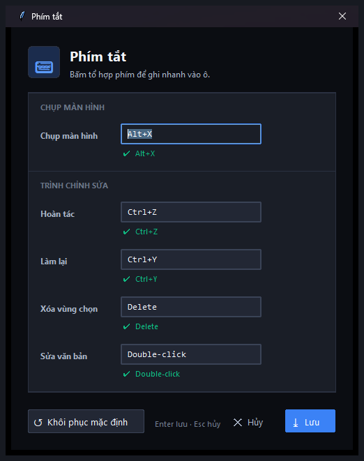
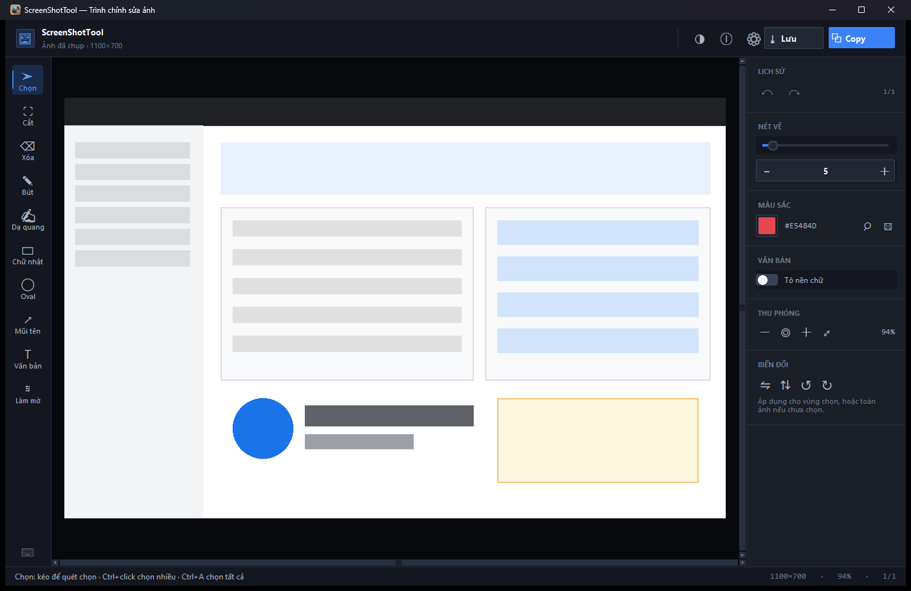

# ScreenShotTool

[](../../actions/workflows/tests.yml)


ScreenShotTool là công cụ chụp màn hình cho Windows, viết bằng Python/Tkinter và Pillow. Ứng dụng chạy nền trong khay hệ thống, hỗ trợ phím tắt chụp nhanh, tự nhận diện cửa sổ/UI khi OpenCV khả dụng, sao chép ảnh vào clipboard và chỉnh sửa ảnh với annotation.

- **Tự cập nhật** từ GitHub Releases: bấm một lần là tool tải bản mới, thay thế chính nó và khởi động lại — không cần tải lại thủ công.
- **Hoàn tác 200 bước** không tốn bộ nhớ, vì các bước chỉ đổi annotation dùng chung một ảnh gốc.
- **Giao diện sáng/tối** chuyển ngay trong editor, giữ nguyên ảnh và lịch sử.
- Toàn bộ xử lý diễn ra trên máy: không có telemetry, không gọi mạng trừ khi bạn bấm **Kiểm tra cập nhật**.


*Editor: rail công cụ bên trái, inspector bên phải, canvas ở giữa với một hình chữ nhật đang được vẽ.*

| | |
|---|---|
|  |  |
| *Cửa sổ hẹp: inspector nổi thành drawer, có nút đóng* | *Dialog thông tin: phím tắt dạng nhóm* |
|  |  |
| *Dialog gán phím tắt: tổ hợp phím được kiểm tra trùng ngay khi bấm* | *Editor trống, sẵn sàng chú thích* |

## Tải bản EXE

Bản chạy độc lập nằm ở tab **[Releases](../../releases/latest)** của repository, file `ScreenShotTool.exe` (one-file, ~72 MB, build từ đúng mã nguồn này). Bản mới nhất hiện là **v1.4.0**.

Tải file EXE về máy Windows rồi chạy trực tiếp. Không cần cài Python hoặc các thư viện trong `requirements.txt`. Windows SmartScreen có thể hiển thị cảnh báo vì file chưa được ký số; đây là binary phát hành nội bộ từ repository này.

Bạn **không cần tự tải lại** khi có bản mới: menu khay → **Kiểm tra cập nhật** sẽ tự tải và thay thế file đang chạy — xem mục **Tự cập nhật** bên dưới.

> Binary không được lưu trong git vì dung lượng lớn. Muốn tự build, xem mục **Đóng gói EXE** bên dưới.

## Cài đặt và chạy EXE

1. Vào tab **Releases**, tải `ScreenShotTool.exe` từ bản phát hành mới nhất.
2. Đặt file vào một thư mục mà tài khoản người dùng có quyền ghi, ví dụ `Documents\ScreenShotTool`.
3. Double-click file EXE để chạy. Ứng dụng sẽ thu nhỏ xuống system tray thay vì mở một cửa sổ chính.
4. Nhấn `Alt+X` để bắt đầu chụp. Có thể mở menu bằng cách click phải vào biểu tượng ScreenShotTool trong system tray.
5. Thoát ứng dụng từ menu tray khi không còn sử dụng.

Ứng dụng lưu cấu hình trong `%APPDATA%\ScreenShotTool\`, không phải cạnh file EXE (xem mục **Cấu hình và log**). Nhờ vậy, **tự cập nhật** thay được file EXE mà không đụng tới cài đặt của bạn, và bạn có thể đặt EXE ở bất kỳ thư mục nào, kể cả thư mục chỉ đọc.

## Chạy từ mã nguồn

Yêu cầu Windows, Python 3.11+ và các dependency trong `requirements.txt`:

```powershell
py -m pip install -r requirements.txt
py ScreenShotTool.pyw
```

Biểu tượng `icon_ScreenShotTool.ico` phải nằm cạnh mã nguồn. Một số tính năng Windows như clipboard, system tray và global hotkey cần chạy trên Windows.

## Hướng dẫn sử dụng

### Chụp màn hình

- `Alt+X`: mở lớp phủ chụp toàn desktop.
- Kéo chuột để chọn một vùng; thả chuột để hoàn tất.
- Click vào một cửa sổ hoặc vùng UI được nhận diện để chụp nhanh vùng đó.
- Di chuyển chuột để xem kính lúp và đường căn chỉnh.
- `Esc`: hủy lần chụp hiện tại.
- `Enter`: chụp toàn bộ màn hình đang trỏ tới, không cần kéo chuột.
- `Space`: chụp cửa sổ đang nằm dưới con trỏ.
- Ảnh sau khi chụp được sao chép vào clipboard nếu clipboard khả dụng. Toast kết quả cho phép mở ảnh trong editor hoặc **ghim** ảnh lên màn hình.

#### Chụp có hẹn giờ

Menu khay → **Chụp sau** → chọn *3 giây* / *5 giây* / *10 giây*.

Hữu ích khi cần mở menu, chờ tooltip hiện, hoặc chờ animation chạy xong trước khi ảnh được "đóng băng". Phím tắt `Alt+X` luôn chụp ngay lập tức — hẹn giờ là đường chủ động.

#### Ghim ảnh lên màn hình

Bấm **Ghim** trên toast kết quả (hoặc mở ảnh rồi dùng cùng nút) để giữ ảnh trong một cửa sổ không viền, luôn nổi trên các cửa sổ khác. Dùng để đối chiếu ảnh tham chiếu với nội dung đang làm.

- Kéo chuột để di chuyển.
- Lăn chuột để đổi độ mờ (25%–100%).
- Nháy đúp, `Esc`, hoặc chuột phải để đóng.

#### Ảnh gần đây

Mỗi lần chụp đều được lưu một bản PNG vào `%APPDATA%\ScreenShotTool\history\`. Menu khay → **Ảnh gần đây** liệt kê 8 ảnh mới nhất; chọn một ảnh để mở lại trong editor. Chỉ giữ **20 ảnh gần nhất** — ảnh cũ hơn tự động bị xóa, nên thư mục không phình ra.

Tính năng này cứu bạn khi lỡ tay chụp đè hoặc đóng editor trước khi lưu. Chọn **Xoá lịch sử ảnh** trong cùng menu để dọn sạch.

### Menu khay hệ thống

| Mục | Tác dụng |
|---|---|
| Chụp màn hình (`Alt+X`) | Chụp ngay |
| Chụp sau | Chụp hẹn giờ 3/5/10 giây |
| Khởi động cùng Windows | Bật/tắt tự chạy khi đăng nhập |
| Mở ảnh… (`Ctrl+O`) | Mở file ảnh có sẵn trong editor |
| Ảnh gần đây | Mở lại ảnh vừa chụp, hoặc xóa lịch sử |
| Kiểm tra cập nhật | Tự tải bản mới và thay thế bản đang chạy |
| Giới thiệu (v…) | Bảng phím tắt và phiên bản |
| Thoát | Thoát hoàn toàn |

**Nếu phím tắt bị ứng dụng khác chiếm:** ScreenShotTool sẽ **thông báo một lần** qua khay hệ thống và ghi vào log, thay vì im lặng để phím không hoạt động. Bạn vẫn chụp được bằng menu khay, hoặc đổi phím trong **Giới thiệu → Gán phím tắt**.

### Tự cập nhật

Menu khay → **Kiểm tra cập nhật**. Tính năng gọi API công khai của GitHub nên chỉ hoạt động khi kho mã nguồn **công khai**; với kho riêng tư, GitHub trả 404 và ứng dụng báo đúng là "không tìm thấy bản phát hành công khai" — không phải lỗi mạng.

Khi có bản mới, tool hỏi rồi **tự tải và thay thế bản cũ**:

1. Tải `ScreenShotTool.exe` của bản mới từ Release vào thư mục tạm, ghi ra file `.part` rồi mới đổi tên — mạng đứt giữa chừng không bao giờ để lại file cụt.
2. Một script phụ chờ tiến trình hiện tại thoát (Windows khoá file đang chạy nên không thể ghi đè tại chỗ), đổi tên file, khởi động lại tool rồi tự xoá.
3. Cấu hình trong `%APPDATA%\ScreenShotTool\` không bị đụng tới, nên cài đặt giữ nguyên sau khi cập nhật.

Nếu tải hoặc thay thế thất bại, bản đang chạy vẫn nguyên vẹn và hộp thoại chỉ rõ file mới nằm ở đâu. Chạy từ mã nguồn (không phải EXE) thì không có gì để thay, nên tool chỉ mở trang Release.

### Chỉnh sửa ảnh

Editor hỗ trợ các công cụ:

- **Chọn**: chọn, kéo di chuyển annotation; `Ctrl+click` chọn nhiều object; kéo marquee để chọn nhóm; `Ctrl+A` chọn tất cả.
- **Cắt**: kéo vùng cần giữ, nhấn `Enter` để xác nhận hoặc `Esc` để hủy.
- **Xóa**: xóa pixel nền trong vùng kéo chọn nhưng giữ annotation trong model.
- **Bút** và **Dạ quang**: vẽ tự do với độ dày và màu đang chọn. Bấm rồi thả mà không kéo sẽ để lại một chấm tròn.
- **Chữ nhật**, **Oval**, **Mũi tên**: thêm hình chú thích; giữ `Shift` khi vẽ oval để tạo hình tròn.
- **Văn bản**: click vào ảnh để nhập chữ; double-click văn bản trong chế độ Chọn để sửa.
- **Làm mờ**: kéo vùng cần làm mờ.

Các thao tác khác trên toolbar gồm đổi màu, đổi độ dày nét, bật nền chữ, zoom, lật ngang/dọc và xoay trái/phải 90 độ.

### Phím tắt editor

| Phím tắt | Tác vụ |
|---|---|
| `Ctrl+Z` | Hoàn tác (giữ tới **200 bước**, chỉ giới hạn bởi bộ nhớ) |
| `Ctrl+Y` | Làm lại |
| `Ctrl+C` | Sao chép ảnh kết quả vào clipboard |
| `Ctrl+S` | Lưu ảnh PNG / WebP / JPEG / BMP |
| `Ctrl+O` | Mở một file ảnh khác |
| `Ctrl+0` | Thu phóng vừa khung |
| `Delete` | Xóa annotation đang chọn |
| Mũi tên | Di chuyển object hoặc nhóm 1 pixel |
| `Shift` + Mũi tên | Di chuyển object hoặc nhóm 10 pixel |
| `Enter` | Xác nhận crop |
| `Esc` | Bỏ chọn hoặc hủy overlay/chỉnh sửa |

Có thể thay đổi phím tắt trong **Giới thiệu → Gán phím tắt**. Tổ hợp phím được kiểm tra trùng lặp trước khi lưu.

### Hoàn tác

Undo/redo dùng **copy-on-write**: mỗi bước lưu một ảnh chụp trạng thái, nhưng các bước chỉ thay đổi annotation thì dùng chung một ảnh gốc, nên một bước gần như không tốn bộ nhớ. Nhờ vậy giới hạn được nâng lên **200 bước** (trước là 50) mà dung lượng vẫn thấp — đo trên ảnh 4K, 31 bước chỉ tốn 31.6 MB thay vì 261 MB.

Hai bảo đảm quan trọng:

- **Bản gốc luôn được giữ.** Khi lịch sử đầy, tool bỏ bước cũ thứ nhì chứ không bỏ bản gốc, nên hoàn tác hết cỡ luôn quay về đúng ảnh lúc mở — không có chuyện object vẽ trước đó "biến mất".
- **Trạng thái đang hiển thị không bao giờ bị cắt.** Bộ nhớ có ngân sách riêng (192 MB); chạm ngưỡng thì bỏ bớt bước cũ chứ không bỏ bước bạn đang xem.

### Lưu và chia sẻ

- Nhấn **Copy** trong editor để đưa ảnh vào clipboard dưới dạng PNG và DIB.
- Nhấn **Lưu** để xuất **PNG**, **WebP**, **JPEG** hoặc **BMP** — đuôi file bạn chọn quyết định định dạng.
  - **WebP** lưu không mất dữ liệu và giữ trong suốt; ảnh chụp màn hình thường nhỏ hơn PNG khoảng 90%, rất tiện khi gửi qua chat hoặc email.
  - **JPEG** và **BMP** không có kênh trong suốt, nên vùng trong suốt được trộn lên nền trắng thay vì thành màu đen.
- Mở lại ảnh có sẵn bằng **Ctrl+O** hoặc menu khay → **Mở ảnh…**.
- Sau khi lật/xoay, annotation được cập nhật theo ảnh và vẫn có thể chọn/di chuyển. Text có thể được rasterize thành bitmap sau một số phép biến đổi.

Khi mở ảnh, editor tự thu phóng **vừa khung** (không bao giờ phóng to ảnh nhỏ hơn khung). Nút `⤢` hoặc `Ctrl+0` để vừa lại khung bất cứ lúc nào.

## Giao diện

Giao diện được cải tổ theo một hệ thống thiết kế riêng, không dùng widget mặc định của Tkinter:

| File | Nội dung |
|---|---|
| `ui_theme.py` | Token thiết kế (màu, khoảng cách, bo góc, font, glyph), engine style cho ttk, và hai bảng màu tối/sáng |
| `ui_widgets.py` | Bộ component tự vẽ trên Canvas: nút, segmented control, slider, switch, color swatch, status bar... để có bo tròn và trạng thái hover/pressed/disabled |
| `ui_capture.py` | Lớp phủ chụp màn hình và toast kết quả |
| `ui_dialogs.py` | Dialog thông tin, phím tắt và hướng dẫn |
| `ui_extras.py` | Lịch sử ảnh gần đây và cửa sổ ghim ảnh nổi |
| `ui_editor_io.py` | Mở/lưu/xuất ảnh của editor (mixin tách riêng) |
| `ui_updates.py` | Kiểm tra, tải và thay thế bản mới |

Editor dùng bố cục ba vùng: header (thao tác chính), rail dọc bên trái (10 công cụ, có tooltip kèm phím tắt), inspector bên phải (Lịch sử / Nét vẽ / Màu sắc / Văn bản / Thu phóng / Biến đổi), canvas ở giữa và thanh trạng thái ở dưới.

**Responsive:** ở cửa sổ hẹp (dưới 1180px) bảng thuộc tính chuyển thành drawer nổi bên phải thay vì bị ẩn, nên mọi điều khiển vẫn truy cập được ở mọi kích thước cửa sổ (tối thiểu 760×520). Đóng drawer bằng nút ×, phím `Esc`, hoặc click vào canvas; mở lại bằng nút bánh răng trên header.

**Sáng / tối:** mặc định bám theo thiết lập *Chế độ ứng dụng* của Windows. Trong editor, bấm nút **◑** ở góc phải header để đổi ngay — cửa sổ đang mở được dựng lại với bảng màu mới, ảnh, annotation, lịch sử hoàn tác và mức thu phóng đều giữ nguyên. Lựa chọn được lưu lại cho các lần mở sau, và mọi cửa sổ editor đang mở khác cũng đổi theo.

Bảng màu sáng đã được kiểm tra độ tương phản WCAG AA (chữ chính ≥ 4.5:1, chữ phụ ≥ 3:1) bằng test tự động.

Line-ending và encoding: mã nguồn Python dùng LF, riêng `tests/test_ui_smoke.py` khi sửa bằng công cụ trên Windows cần chú ý CRLF (git tự chuẩn hoá khi commit).

## Đóng gói EXE

Lệnh build one-file/windowed bằng PyInstaller:

```powershell
py -m pip install pyinstaller
py -m PyInstaller --noconfirm --clean --onefile --windowed `
  --name ScreenShotTool `
  --icon icon_ScreenShotTool.ico `
  --add-data "icon_ScreenShotTool.ico;." `
  --collect-submodules pystray --collect-submodules PIL `
  --hidden-import win32clipboard --hidden-import win32gui `
  --hidden-import win32con --hidden-import win32api `
  --hidden-import pystray._win32 --hidden-import keyboard `
  --hidden-import cv2 --hidden-import numpy `
  --hidden-import ui_editor_io --hidden-import ui_updates --hidden-import ui_extras `
  --exclude-module matplotlib --exclude-module pytest `
  ScreenShotTool.pyw
```

File tạo ra nằm trong `dist\ScreenShotTool.exe` (~72 MB). Binary này **không** được commit vào git.

### Phát hành

Có hai cách, cả hai đều **chạy toàn bộ test trước** rồi mới build (`needs: unit-tests` trong `.github/workflows/release.yml`):

1. **Tự động:** đẩy một tag, CI build và đính kèm exe vào Release.

   ```powershell
   git tag -a v1.1.0 -m "ScreenShotTool v1.1.0"
   git push origin v1.1.0
   ```

   Workflow sẽ chạy test, build, tạo Release và đính kèm `SHA256SUMS.txt` cạnh file EXE.

2. **Thủ công từ máy:** build rồi tự tạo Release (test không được tự chạy ở đây — phải tự đảm bảo đã chạy `unittest` và `ruff` trước).

   ```powershell
   gh release create v1.1.0 dist\ScreenShotTool.exe --title "v1.1.0" --notes-file notes.md
   ```

## Kiểm thử

```powershell
python -m ruff check .
python -m unittest discover -s tests -v
```

Bộ test gồm **329 test**:

| File | Số test | Nội dung |
|---|---|---|
| `tests/test_transform.py` | 12 | Test gốc, **không chỉnh sửa**, kiểm tra logic biến đổi |
| `tests/test_ui_parity.py` | 86 | Hệ thống thiết kế: token, helper màu, component, hành vi widget |
| `tests/test_ui_smoke.py` | 71 | Tích hợp trên ứng dụng thật: contract, đường dẫn sự kiện, wiring dialog |
| `tests/test_runtime_paths.py` | 39 | Đường lỗi: config hỏng/thiếu, clipboard khoá, registry, thiếu icon, hotkey bị chiếm |
| `tests/test_ui_features.py` | 61 | Undo copy-on-write + ngân sách bộ nhớ, sàn hoàn tác giữ nguyên bản gốc, fit-to-window, debounce resize, 4 định dạng xuất, lịch sử ảnh, ghim ảnh, đổi theme trực tiếp trong editor + tương phản WCAG, chấm tròn cho bút/dạ quang, bố cục toast |
| `tests/test_updates.py` | 31 | So sánh phiên bản, lý do lỗi (404 / mất mạng / rate limit), callback nền, chọn asset, tải về (không để lại file dở), script thay thế bản cũ |
| `tests/test_tray_regressions.py` | 18 | Chống tái phát 3 lỗi v1.2.0: menu khay crash, "Giới thiệu" không mở, báo sai lỗi mạng |
| `tests/test_multi_monitor.py` | 11 | Toạ độ đa màn hình (gốc âm), snapping cửa sổ, DPI awareness |

Đo độ phủ:

```powershell
python -m coverage run --source=. -m unittest discover -s tests
python -m coverage report --skip-covered --omit="tests/*,_*.py"
```

Ngoài ra `tests/visual_check.py` là script (không phải unittest) chụp ảnh giao diện ở nhiều kích thước cửa sổ để kiểm tra bằng mắt.

Báo cáo kiểm định độc lập (đợt cải tổ giao diện, tài liệu lịch sử): [`docs/REDESIGN_VERIFICATION.md`](docs/REDESIGN_VERIFICATION.md).

## Lịch sử phiên bản

Xem [`CHANGELOG.md`](CHANGELOG.md) để có danh sách đầy đủ — mỗi bản ghi rõ phần **Thêm mới / Thay đổi / Sửa lỗi** và liên kết so sánh trên GitHub.

| Phiên bản | Thay đổi chính |
|---|---|
| **v1.4.0** | Toast không còn lệch nút Ghim; tự tải và thay thế bản cũ khi cập nhật; bút/dạ quang bấm một lần vẽ được chấm tròn; hoàn tác không còn mất object khi vượt giới hạn (nâng lên 200 bước và giữ bản gốc) |
| v1.3.0 | Đổi giao diện sáng/tối ngay trong editor; sửa hộp thoại Giới thiệu không hiện khi mở từ khay |
| v1.2.1 | Sửa menu khay bị lỗi, mục "Giới thiệu" không mở, và thông báo sai lỗi mạng khi kiểm tra cập nhật |
| v1.2.0 | Toast kết quả, ghim ảnh nổi, ảnh gần đây, phím tắt tuỳ chỉnh |
| v1.1.1 | Ký số tuỳ chọn trong workflow phát hành |
| v1.1.0 | Bộ widget tự vẽ, giao diện tối/sáng, inspector dạng drawer, chụp hẹn giờ, kiểm tra cập nhật |
| v1.0.0 | Bản phát hành đầu tiên |

## Phụ thuộc và giới hạn

- OpenCV/NumPy cung cấp khả năng tự nhận diện các vùng UI; nếu thiếu, chụp kéo vùng vẫn hoạt động.

  Phần **số học** của snapping đa màn hình (trục toạ độ âm khi màn hình phụ nằm bên trái/trên) đã được test trong `tests/test_multi_monitor.py`. Phần **chưa ai kiểm chứng trên phần cứng thật**: hai màn hình ở tỉ lệ DPI khác nhau (ví dụ laptop 150% + màn ngoài 100%). Nếu bạn gặp lỗi lệch vùng chọn ở cấu hình đó, hãy báo kèm thông tin DPI. Clipboard bị khoá bởi ứng dụng khác, UAC và cửa sổ DRM cũng chưa được kiểm thử thủ công.
- EXE chưa được ký số, vì vậy Windows SmartScreen có thể cảnh báo. Xem mục **Chữ ký số** bên dưới để biết cách xử lý và cách bật ký tự động.
- Khi biến đổi riêng lẻ, text annotation có thể trở thành bitmap và không còn sửa nội dung như text vector.

## Cấu hình và log

| Đường dẫn | Nội dung |
|---|---|
| `%APPDATA%\ScreenShotTool\ScreenShotTool_config.json` | Cấu hình (màu, độ dày, phím tắt, giao diện sáng/tối) |
| `%APPDATA%\ScreenShotTool\ScreenShotTool.log` | Log, tự cắt vòng ở ~1 MB |
| `%APPDATA%\ScreenShotTool\history\` | 20 ảnh chụp gần nhất (tự tạo khi chụp lần đầu) |
| `%TEMP%\ScreenShotTool-<phiên bản>.exe` | Bản mới đang chờ thay thế (chỉ tồn tại trong lúc cập nhật) |

File cấu hình đọc được cả khi có BOM UTF-8 (Notepad và PowerShell đều ghi BOM), nên sửa tay bằng Notepad không làm mất cài đặt.

Menu khay → **Ảnh gần đây** → **Xoá lịch sử ảnh** để dọn thư mục `history\` bất cứ lúc nào.

Ghi cấu hình là **nguyên tử**: ghi file tạm rồi đổi tên, nên mất điện giữa lúc ghi không làm hỏng file.

Cấu hình cũ đặt cạnh file EXE hoặc trong thư mục làm việc vẫn được đọc khi nâng cấp, nên không mất cài đặt; lần ghi tiếp theo sẽ chuyển về `%APPDATA%`.

## Giấy phép

[MIT](LICENSE).

## Đóng góp

Xem [`CONTRIBUTING.md`](CONTRIBUTING.md). Tóm tắt: chạy `ruff` và toàn bộ test trước khi gửi PR, comment bằng tiếng Anh, chuỗi hiển thị bằng tiếng Việt. Phần logic vẽ/transform được khoá bởi `tests/test_transform.py` — không sửa test đó để code chạy qua.

## Chữ ký số và SmartScreen

### Nếu bạn tải và chạy

Bản phát hành hiện **chưa được ký số**, nên lần chạy đầu Windows SmartScreen có thể hiện: *"Windows protected your PC"*.

Cách chạy:

1. Bấm **More info**
2. Bấm **Run anyway**

Sau lần chạy đầu, Windows ghi nhớ file đó và không hỏi lại (trừ khi file thay đổi).

Muốn chắc chắn file tải về không bị chỉnh sửa trên đường truyền, mỗi Release có kèm file `SHA256SUMS.txt`:

```powershell
Get-FileHash .\ScreenShotTool.exe -Algorithm SHA256
# so với nội dung SHA256SUMS.txt trong cùng Release
```

### Bật ký số tự động

Workflow phát hành đã có bước ký sẵn. Nó **tự bỏ qua** khi chưa có chứng chỉ, và **tự bật** khi bạn thêm hai secret vào repository:

| Secret | Nội dung |
|---|---|
| `SIGNING_CERT_BASE64` | Nội dung file `.pfx` mã hoá base64 |
| `SIGNING_CERT_PASSWORD` | Mật khẩu của file `.pfx` |

Tạo chuỗi base64:

```powershell
[Convert]::ToBase64String([IO.File]::ReadAllBytes("chungchi.pfx")) | Set-Clipboard
```

Thêm secret bằng giao diện GitHub (Settings → Secrets and variables → Actions) hoặc:

```powershell
gh secret set SIGNING_CERT_BASE64 --repo btanh258/ScreenShotTool < cert.b64
gh secret set SIGNING_CERT_PASSWORD --repo btanh258/ScreenShotTool
```

Sau đó mọi Release đều được ký và kiểm tra chữ ký hợp lệ trước khi phát hành.

### Về việc mua chứng chỉ

Không có cách nào để bản phát hành miễn phí hết cảnh báo SmartScreen. Danh tiếng SmartScreen được tích luỹ theo **chứng chỉ**, không theo file: một chứng chỉ mới vẫn bị cảnh báo cho tới khi có đủ lượt tải. Chứng chỉ EV được nhiều nơi quảng cáo là bỏ qua giai đoạn đó, nhưng cần xác minh với nhà cung cấp tại thời điểm mua.

Chứng chỉ EV cần **xác minh doanh nghiệp** (giấy phép kinh doanh), nên cá nhân thường không mua được. Chứng chỉ OV dành cho cá nhân có thể mua nhưng đắt hơn giá trị một công cụ nội bộ nhỏ. Đây là lý do dự án chọn cách **công bố rõ là chưa ký** thay vì ký bằng chứng chỉ tự tạo — chứng chỉ tự tạo còn tệ hơn không ký, vì nó làm cảnh báo trông đáng ngại hơn.

Điều thực sự giúp người dùng tin tưởng ở đây là mã nguồn mở và CI công khai: họ đọc được code, thấy test chạy.


